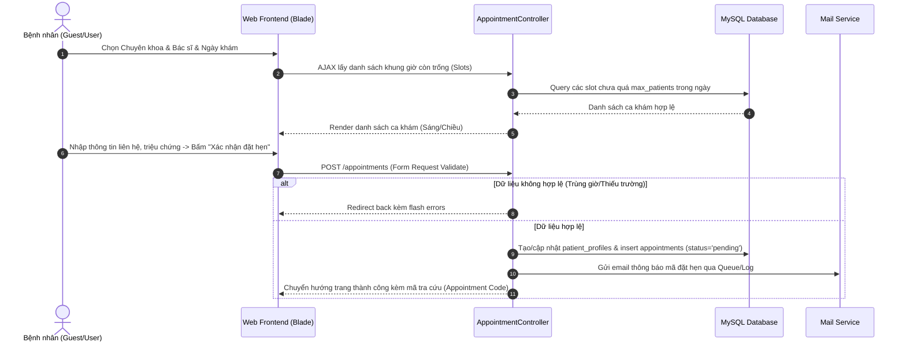
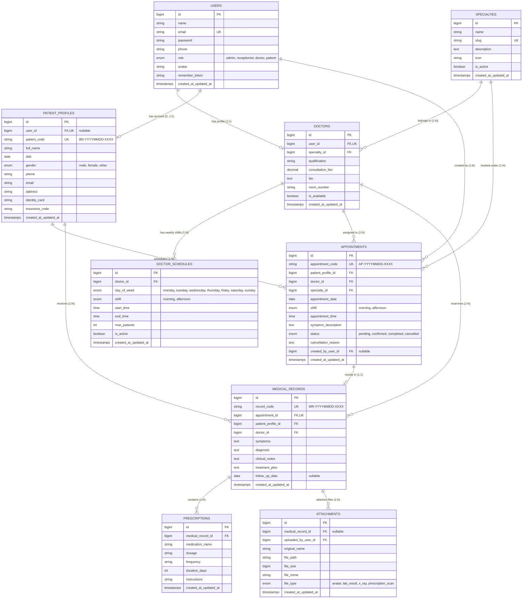
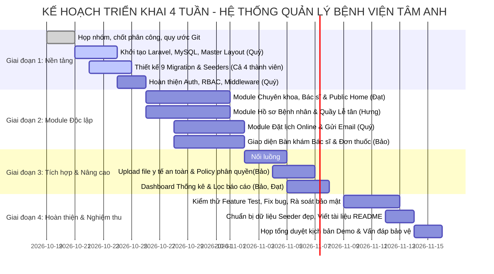

# KẾ HOẠCH TRIỂN KHAI ĐỒ ÁN: HỆ THỐNG QUẢN LÝ BỆNH VIỆN TÂM ANH
**Học phần:** Phát triển ứng dụng Web (PHP - Laravel - MySQL)  
**Nhóm sinh viên thực hiện:**
1. **Nguyễn Thành Quý** (Technical Lead & System Architect)
2. **Nguyễn Văn Đạt** (Backend & Frontend Developer: Chuyên khoa & Bác sĩ)
3. **Nguyễn Văn Hưng** (Backend & Frontend Developer: Bệnh nhân & Tiếp nhận)
4. **Võ Lê Gia Bảo** (Backend & Frontend Developer: Khám bệnh, Hồ sơ y tế & Báo cáo)

---

## 1. TÓM TẮT ĐỀ TÀI VÀ CÁC GIẢ ĐỊNH

### 1.1. Tóm tắt đề tài
Hệ thống Quản lý Bệnh viện Tâm Anh là ứng dụng Web đa người dùng được phát triển trên nền tảng **Laravel Framework (PHP 8.2+)** kết hợp cơ sở dữ liệu **MySQL**, mô phỏng quy trình tiếp nhận, đặt lịch khám, điều phối và lập hồ sơ khám chữa bệnh ngoại trú tại bệnh viện đa khoa.

Hệ thống giải quyết 4 bài toán cốt lõi:
- Cung cấp cổng thông tin công khai giúp người dân tra cứu chuyên khoa, bác sĩ, bảng giá và đặt lịch khám trực tuyến.
- Tự động hóa khâu tiếp nhận của nhân viên lễ tân: tiếp đón bệnh nhân đặt trước hoặc đăng ký trực tiếp (walk-in), cấp mã hồ sơ y tế chuẩn hóa.
- Hỗ trợ bác sĩ quản lý danh sách khám trong ca, ghi nhận chẩn đoán, kê đơn thuốc mẫu và lưu trữ kết quả cận lâm sàng (file đính kèm).
- Cung cấp cho Ban quản trị công cụ giám sát thống kê, điều phối bác sĩ và quản trị tài nguyên hệ thống.

### 1.2. Các giả định kỹ thuật và nghiệp vụ
1. **Môi trường cục bộ:** Giả định nhóm sử dụng máy tính Windows với môi trường chạy ứng dụng chuẩn: PHP 8.2 (tích hợp trong XAMPP hoặc standalone), MySQL 8.0/MariaDB, Composer 2.x, Git 2.4x.
2. **Quy mô đồ án:** Hệ thống tập trung vào mô hình khám chữa bệnh ngoại trú (Outpatient Department - OPD). Tạm thời không đưa vào phạm vi: quản lý nội trú (giường bệnh), kho dược phẩm chuyên sâu (tồn kho, hạn dùng lô thuốc), cổng thanh toán liên ngân hàng trực tiếp (VNPay/Momo - thay bằng xác nhận viện phí mẫu tại quầy).
3. **Mô phỏng Email & Tệp tin:**
   - Dịch vụ gửi email được kiểm thử an toàn qua Mailpit (tích hợp sẵn trong Laravel Sail / cục bộ) hoặc `log` mail driver / tài khoản Mailtrap miễn phí.
   - Tài liệu đính kèm (kết quả xét nghiệm, X-quang) được lưu trữ cục bộ trong thư mục `storage/app/private/medical_records` và chỉ được truy xuất thông qua Controller có kiểm tra quyền (Signed URL / Gate Authorization), không public ra ngoài web root.
4. **Dữ liệu giả lập (Mock Data):** Toàn bộ dữ liệu bệnh nhân, bác sĩ, triệu chứng và bệnh án là dữ liệu ngẫu nhiên sinh bằng Laravel Seeder & Faker, tuyệt đối không sử dụng thông tin y tế của người thật.
5. **Thời gian biểu dự án:** Giả định tiến độ triển khai trong **04 tuần (28 ngày làm việc)** chia thành 4 sprint rõ ràng.

---

## 2. PHẠM VI MVP, CHỨC NĂNG MỞ RỘNG VÀ CHỨC NĂNG TÙY CHỌN

```
+--------------------------------------------------------------------------+
|                       TẦNG 3: NÂNG CAO - TÙY CHỌN                        |
|  - Xuất phiếu khám/đơn thuốc dạng PDF (DomPDF).                          |
|  - Giao diện Dark/Light mode ghi nhớ bằng Cookie.                        |
|  - Thống kê biểu đồ Chart.js trực quan trên Admin Dashboard.             |
+--------------------------------------------------------------------------+
|                       TẦNG 2: MỞ RỘNG - NÊN CÓ                           |
|  - Bệnh nhân đăng ký/quản lý tài khoản portal để xem lịch sử khám.       |
|  - Gửi Email tự động: Thông báo đặt lịch & Email xác nhận kết quả khám.  |
|  - Upload file hồ sơ khám (ảnh/PDF) có phân quyền tải an toàn.          |
|  - Tìm kiếm AJAX, bộ lọc đa tiêu chí và sắp xếp phân trang dữ liệu.     |
+--------------------------------------------------------------------------+
|                       TẦNG 1: MVP - BẮT BUỘC (CỐT LÕI)                   |
|  - Xác thực (Auth), đổi mật khẩu, phân quyền 4 vai trò (RBAC).           |
|  - Quản lý Chuyên khoa (CRUD) & Bác sĩ (CRUD, gán chuyên khoa).          |
|  - Quản lý Hồ sơ bệnh nhân (tạo mã BN tự động, tra cứu thông tin).       |
|  - Đăng ký & Điều phối lịch khám (chọn bác sĩ, ca khám, tránh trùng ca). |
|  - Bác sĩ cập nhật kết quả khám (Chẩn đoán, lời dặn, trạng thái).        |
|  - Giao diện Responsive chuẩn Bootstrap 5 & Flash notification.          |
+--------------------------------------------------------------------------+
```

### Chi tiết phân loại:
- **MVP (Bắt buộc phải hoàn thành 100% trong Tuần 1 - Tuần 3):**
  - Đăng nhập/Đăng xuất/Đổi mật khẩu bảo vệ bằng CSRF, Password Hash (Bcrypt), Session Guard.
  - Phân quyền 4 vai trò: Admin, Lễ tân (Receptionist), Bác sĩ (Doctor), Bệnh nhân (Patient).
  - Quản lý danh mục Chuyên khoa và Danh sách Bác sĩ.
  - Đặt lịch khám: Lễ tân đặt cho khách hoặc Bệnh nhân tự đặt trực tuyến. Kiểm tra logic tránh trùng ca khám của bác sĩ.
  - Khám bệnh: Bác sĩ xem danh sách bệnh nhân theo ngày, nhập chẩn đoán, kết luận đơn giản.
  - Dashboard cơ bản hiển thị các chỉ số đếm số lượng thực tế trong database.
- **Mở rộng (Thực hiện trong Tuần 3 - Tuần 4):**
  - Gửi Mail xác nhận đặt lịch thành công qua Queue/Mailable.
  - Upload file kết quả xét nghiệm / đơn thuốc đính kèm (giới hạn PDF, PNG, JPG, tối đa 2MB).
  - Quản lý Session & Cookie ghi nhớ tùy chọn (chuyên khoa quan tâm, banner thông báo, remember token).
- **Nâng cao (Chỉ làm khi MVP đã qua kiểm thử nghiệm thu):**
  - Xuất hóa đơn/phiếu khám ra file PDF bằng `barryvdh/laravel-dompdf`.
  - Biểu đồ thống kê doanh thu và lượng khám 7 ngày gần nhất qua Chart.js.

---

## 3. DANH SÁCH VAI TRÒ VÀ MA TRẬN PHÂN QUYỀN (RBAC)

Hệ thống thiết lập 4 vai trò rõ ràng, kiểm soát chặt chẽ ở cấp Middleware, Policy và Form Request:

| Module / Hành động | Admin (Quản trị viên) | Receptionist (Lễ tân) | Doctor (Bác sĩ) | Patient (Bệnh nhân) | Guest (Khách vãng lai) |
| :--- | :---: | :---: | :---: | :---: | :---: |
| **Xem Trang chủ, Bác sĩ, Chuyên khoa** | Toàn quyền | Toàn quyền | Toàn quyền | Toàn quyền | Toàn quyền |
| **Đăng ký tài khoản bệnh nhân** | Có thể tạo | Có thể tạo | - | Tự đăng ký | Tự đăng ký |
| **Quản lý Tài khoản người dùng (Users)** | Toàn quyền CRUD | Xem danh sách BN | - | Chỉ xem/sửa hồ sơ mình | - |
| **Quản lý Chuyên khoa (Specialties)** | Toàn quyền CRUD | Chỉ xem | Chỉ xem | Chỉ xem | Chỉ xem |
| **Quản lý Bác sĩ & Lịch làm việc** | Toàn quyền CRUD | Xem lịch trực | Xem/sửa lịch mình | Chỉ xem lịch trống | Chỉ xem lịch trống |
| **Quản lý Hồ sơ bệnh nhân (Profiles)** | Toàn quyền | CRUD hồ sơ BN | Xem BN mình khám | Chỉ xem hồ sơ mình | - |
| **Đặt lịch khám (Appointments)** | Điều phối / Hủy | Tạo / Duyệt / Đổi ca | Xem lịch của mình | Tự đặt / Hủy lịch mình | Đặt lịch (tạo profile tạm) |
| **Tiếp nhận & Cập nhật trạng thái khám** | Xem / Can thiệp | Đổi: Chờ khám, Checkin | Đổi: Đang khám, Đã khám | Chỉ theo dõi trạng thái | - |
| **Lập Hồ sơ bệnh án & Kết quả khám** | Xem thống kê | - | Tạo / Sửa bệnh án mình | Chỉ xem bệnh án của mình | - |
| **Upload / Xem tệp đính kèm y tế** | Quản trị file | Tải lên giấy tờ BN | Upload kết quả X-quang | Tải về hồ sơ của mình | - |
| **Xem Dashboard Thống kê tổng hợp** | Toàn hệ thống | Báo cáo ca trực ngày | Thống kê số ca khám | Xem lịch sử cá nhân | - |

> [!IMPORTANT]
> **Quy tắc bảo mật phân quyền:** Kiểm tra quyền hạn không chỉ thực hiện bằng cách ẩn nút trên giao diện Blade (`@can`, `@if(auth()->user()->role === ...)`), mà bắt buộc phải validate tại Middleware (`role:admin,doctor`) và Laravel Policy (`authorize('update', $appointment)`). Bệnh nhân A tuyệt đối không được xem hay sửa lịch khám hoặc bệnh án của Bệnh nhân B.

---

## 4. QUY TRÌNH NGHIỆP VỤ VÀ USE CASE CHI TIẾT

### 4.1. Quy trình Đặt lịch khám trực tuyến (Online Booking Flow)


### 4.2. Quy trình Tiếp nhận tại quầy (Receptionist Walk-in & Check-in Flow)
- **Tác nhân:** Nhân viên tiếp nhận (Receptionist).
- **Đầu vào:** Bệnh nhân đến quầy khai báo Họ tên, Số điện thoại hoặc Mã hẹn trước.
- **Xử lý:**
  1. Lễ tân nhập SĐT vào ô tra cứu nhanh. Hệ thống tìm kiếm trong bảng `patient_profiles`.
  2. Nếu là bệnh nhân mới: Bấm "Tạo nhanh hồ sơ", hệ thống tự cấp `patient_code` dạng `BN-YYYYMMDD-XXXX`.
  3. Nếu có hẹn trước: Chuyển trạng thái lịch từ `pending` sang `confirmed` (Đã tiếp nhận) và gán số thứ tự khám (Queue Number) trong ca.
  4. Nếu bệnh nhân vãng lai (Walk-in): Chọn bác sĩ trực theo chuyên khoa, kiểm tra số lượng bệnh nhân hiện tại của bác sĩ, nếu còn slot thì tạo lịch khám mới với trạng thái `confirmed`.
- **Đầu ra:** Phiếu số thứ tự tiếp nhận, cập nhật danh sách chờ trên màn hình của Bác sĩ.

### 4.3. Quy trình Bác sĩ khám bệnh và Lưu hồ sơ y tế (Doctor Examination Flow)
- **Tác nhân:** Bác sĩ (Doctor).
- **Đầu vào:** Bác sĩ mở màn hình "Danh sách chờ khám hôm nay". Bấm chọn bệnh nhân kế tiếp.
- **Xử lý:**
  1. Chuyển trạng thái lịch khám sang `in_progress` (Đang khám).
  2. Xem tiền sử bệnh lý và các lần khám trước của bệnh nhân qua liên kết `patient_profile_id`.
  3. Nhập: Triệu chứng thực thể, Chẩn đoán sơ bộ, Kết luận bệnh, Lời dặn tái khám.
  4. Thêm đơn thuốc mẫu (Tên thuốc, số lượng, liều dùng, cách dùng).
  5. Đính kèm file kết quả chụp chiếu (nếu có): Hệ thống kiểm tra mime type (pdf, jpg, png), dung lượng (<3MB), lưu vào `storage/app/private/medical_records/` và ghi metadata vào bảng `attachments`.
  6. Bấm "Hoàn thành ca khám": Hệ thống tạo record trong `medical_records`, cập nhật lịch hẹn sang `completed`.
- **Đầu ra:** Bệnh án được lưu vĩnh viễn, bệnh nhân có thể xem lại trong portal, bác sĩ hoàn thành lượt khám.

---

## 5. KIẾN TRÚC TỔNG THỂ LARAVEL (MVC)

### 5.1. Cấu trúc thư mục tổ chức mã nguồn
```
He-Thong-Quan-Ly-Benh-Vien-Tam-Anh/
├── app/
│   ├── Http/
│   │   ├── Controllers/
│   │   │   ├── Auth/                     # Đăng nhập, đăng ký, profile, đổi pass
│   │   │   ├── Admin/                    # Quản trị hệ thống, Dashboard, User CRUD
│   │   │   ├── Receptionist/             # Tiếp đón, Check-in, Quản lý bệnh nhân
│   │   │   ├── Doctor/                   # Khám bệnh, Hồ sơ bệnh án, Kê đơn
│   │   │   └── Public/                   # Trang chủ, tra cứu, đặt lịch vãng lai
│   │   ├── Middleware/
│   │   │   ├── CheckRole.php             # Chặn quyền theo vai trò (admin, doctor, ...)
│   │   │   └── SecurityHeaders.php       # Chống clickjacking, XSS headers
│   │   └── Requests/                     # Form Request validation tách biệt
│   │       ├── StoreAppointmentRequest.php
│   │       ├── StoreDoctorRequest.php
│   │       ├── StorePatientRequest.php
│   │       └── StoreMedicalRecordRequest.php
│   ├── Models/                           # Eloquent Models & Relationships
│   │   ├── User.php
│   │   ├── Specialty.php
│   │   ├── Doctor.php
│   │   ├── DoctorSchedule.php
│   │   ├── PatientProfile.php
│   │   ├── Appointment.php
│   │   ├── MedicalRecord.php
│   │   ├── Prescription.php
│   │   └── Attachment.php
│   └── Mail/                             # Mailable Classes
│       ├── AppointmentCreatedMail.php
│       └── AppointmentStatusUpdatedMail.php
├── database/
│   ├── migrations/                       # 9 migration tuần tự, chuẩn hóa khóa ngoại
│   ├── seeders/                          # DatabaseSeeder tạo sẵn dữ liệu mẫu phong phú
│   └── factories/                        # Model factories phục vụ test
├── resources/
│   └── views/
│       ├── layouts/                      # Layout Blade dùng chung
│       │   ├── master.blade.php          # Khung trang ngoài
│       │   ├── admin.blade.php           # Khung trang Dashboard quản trị
│       │   ├── partials/                 # Header, Footer, Sidebar, Alert, Breadcrumb
│       │   └── components/               # Blade Components (card, button, modal, badge)
│       ├── public/                       # Trang công khai: Home, About, Doctors, Booking
│       ├── admin/                        # Giao diện cho Admin
│       ├── receptionist/                 # Giao diện cho Lễ tân
│       ├── doctor/                       # Giao diện cho Bác sĩ
│       └── patient/                      # Giao diện Portal Bệnh nhân
├── routes/
│   ├── web.php                           # Route chính, gom nhóm theo namespace & role
│   └── auth.php                          # Route xác thực
└── storage/
    └── app/
        ├── public/avatars/               # Ảnh đại diện công khai
        └── private/medical_records/      # File y tế nhạy cảm (bảo vệ quyền tải)
```

### 5.2. Giải pháp Giao diện thống nhất
- **Framework giao diện:** Sử dụng **Bootstrap 5.3 (CSS & JS Bundle)**.
  - *Lý do kỹ thuật:* Đảm bảo tương thích tuyệt đối cho cả 4 thành viên, không phụ thuộc cấu hình Node.js/Vite phức tạp, dễ dàng tích hợp qua CDN hoặc asset local, có sẵn hệ thống Grid, Modal, Toast, Table, Form validation styles chuẩn mực cho đề tài quản lý.
- **Bảng màu nhận diện y tế (Medical Trust Palette):**
  - Primary: `#0284C7` (Sky Blue - chuyên nghiệp, tin cậy)
  - Success/Accent: `#0D9488` (Teal Hospital - thanh khiết, an tâm)
  - Dark Neutral: `#1E293B` (Slate - văn bản rõ ràng)
  - Background: `#F8FAFC` (Off-white - sạch sẽ, chuẩn y khoa)
- **Tổ chức Blade Components tái sử dụng:**
  - `<x-alert />`: Tự động render flash messages (`success`, `error`, `warning`).
  - `<x-page-header title="..." />`: Tiêu đề trang đồng nhất kèm nút tác vụ.
  - `<x-status-badge :status="$status" />`: Đổi màu badge theo trạng thái lịch khám (`pending`: vàng, `confirmed`: xanh dương, `completed`: xanh lá, `cancelled`: đỏ).

---

## 6. ERD VÀ THIẾT KẾ CHI TIẾT CÁC BẢNG MYSQL

### 6.1. Sơ đồ thực thể mối quan hệ (ERD Mermaid)



### 6.2. Thiết kế chi tiết các bảng cơ sở dữ liệu

#### Bảng 1: `users` (Tài khoản người dùng & Phân quyền)
- **Mục đích:** Lưu trữ định danh, thông tin đăng nhập và phân quyền hệ thống.
- **Cấu trúc:**
  - `id`: BIGINT UNSIGNED, PK, Auto Increment.
  - `name`: VARCHAR(100), NOT NULL - Họ tên hiển thị.
  - `email`: VARCHAR(150), NOT NULL, UNIQUE - Email đăng nhập.
  - `password`: VARCHAR(255), NOT NULL - Mật khẩu đã hash (Bcrypt).
  - `phone`: VARCHAR(20), NULLABLE - Số điện thoại.
  - `role`: ENUM('admin', 'receptionist', 'doctor', 'patient'), DEFAULT 'patient', NOT NULL.
  - `avatar`: VARCHAR(255), NULLABLE - Đường dẫn ảnh đại diện.
  - `remember_token`: VARCHAR(100), NULLABLE.
  - `created_at`, `updated_at`: TIMESTAMP.
- **Index:** `email` (UNIQUE), `role` (INDEX).
- **Dữ liệu mẫu:** `admin@tamanh.vn`, `receptionist@tamanh.vn`, `doctor.hung@tamanh.vn`, `patient.an@gmail.com`.

#### Bảng 2: `specialties` (Danh mục Chuyên khoa)
- **Mục đích:** Phân loại các khoa điều trị (Tim mạch, Nhi, Tai Mũi Họng,...).
- **Cấu trúc:**
  - `id`: BIGINT UNSIGNED, PK, Auto Increment.
  - `name`: VARCHAR(150), NOT NULL - Tên chuyên khoa.
  - `slug`: VARCHAR(180), NOT NULL, UNIQUE - Đường dẫn thân thiện URL.
  - `description`: TEXT, NULLABLE - Giới thiệu về chuyên khoa.
  - `icon`: VARCHAR(100), NULLABLE - Icon FontAwesome hoặc Bootstrap Icons.
  - `is_active`: BOOLEAN, DEFAULT TRUE - Trạng thái hoạt động.
  - `created_at`, `updated_at`: TIMESTAMP.
- **Dữ liệu mẫu:** Tim mạch học (`tim-mach`), Nhi khoa (`nhi-khoa`), Chấn thương chỉnh hình (`chan-thuong-chinh-hinh`).

#### Bảng 3: `doctors` (Hồ sơ Bác sĩ)
- **Mục đích:** Mở rộng thông tin y tế chuyên môn cho tài khoản Bác sĩ (liên kết 1-1 với `users`).
- **Cấu trúc:**
  - `id`: BIGINT UNSIGNED, PK, Auto Increment.
  - `user_id`: BIGINT UNSIGNED, NOT NULL, UNIQUE, FK -> `users(id)` ON DELETE CASCADE.
  - `specialty_id`: BIGINT UNSIGNED, NOT NULL, FK -> `specialties(id)` ON DELETE RESTRICT.
  - `qualification`: VARCHAR(100), NOT NULL - Học vị (TS.BS, ThS.BS, Bác sĩ CKI,...).
  - `consultation_fee`: DECIMAL(12,2), DEFAULT 300000.00 - Giá khám cơ bản.
  - `bio`: TEXT, NULLABLE - Tóm tắt kinh nghiệm công tác.
  - `room_number`: VARCHAR(50), NOT NULL - Phòng khám (ví dụ: Phòng 302, Tòa A).
  - `is_available`: BOOLEAN, DEFAULT TRUE - Trạng thái sẵn sàng nhận lịch.
  - `created_at`, `updated_at`: TIMESTAMP.
- **Index:** `user_id` (UNIQUE), `specialty_id` (INDEX).

#### Bảng 4: `patient_profiles` (Hồ sơ Bệnh nhân)
- **Mục đích:** Lưu trữ hồ sơ y tế hành chính của bệnh nhân. Hỗ trợ cả bệnh nhân có tài khoản online lẫn bệnh nhân vãng lai do Lễ tân tạo tại quầy.
- **Cấu trúc:**
  - `id`: BIGINT UNSIGNED, PK, Auto Increment.
  - `user_id`: BIGINT UNSIGNED, NULLABLE, UNIQUE, FK -> `users(id)` ON DELETE SET NULL.
  - `patient_code`: VARCHAR(30), NOT NULL, UNIQUE - Mã hồ sơ (VD: `BN-20261016-0001`).
  - `full_name`: VARCHAR(100), NOT NULL - Họ tên bệnh nhân.
  - `dob`: DATE, NOT NULL - Ngày sinh.
  - `gender`: ENUM('male', 'female', 'other'), NOT NULL.
  - `phone`: VARCHAR(20), NOT NULL - SĐT liên lạc.
  - `email`: VARCHAR(150), NULLABLE.
  - `address`: VARCHAR(255), NULLABLE - Địa chỉ cư trú.
  - `identity_card`: VARCHAR(20), NULLABLE - Số CCCD.
  - `insurance_code`: VARCHAR(30), NULLABLE - Mã thẻ BHYT.
  - `created_at`, `updated_at`: TIMESTAMP.
- **Index:** `patient_code` (UNIQUE), `phone` (INDEX), `user_id` (INDEX).

#### Bảng 5: `doctor_schedules` (Lịch trực / Ca khám của Bác sĩ)
- **Mục đích:** Cấu hình khung thời gian định kỳ trong tuần để hệ thống tự động sinh slot đặt lịch.
- **Cấu trúc:**
  - `id`: BIGINT UNSIGNED, PK, Auto Increment.
  - `doctor_id`: BIGINT UNSIGNED, NOT NULL, FK -> `doctors(id)` ON DELETE CASCADE.
  - `day_of_week`: ENUM('monday','tuesday','wednesday','thursday','friday','saturday','sunday'), NOT NULL.
  - `shift`: ENUM('morning', 'afternoon'), NOT NULL (Morning: 07:30 - 11:30, Afternoon: 13:30 - 17:00).
  - `start_time`: TIME, NOT NULL.
  - `end_time`: TIME, NOT NULL.
  - `max_patients`: INT UNSIGNED, DEFAULT 15 - Giới hạn tối đa ca khám để tránh quá tải.
  - `is_active`: BOOLEAN, DEFAULT TRUE.
  - `created_at`, `updated_at`: TIMESTAMP.
- **Index:** Composite Index `(doctor_id, day_of_week, shift)` (UNIQUE).

#### Bảng 6: `appointments` (Lịch hẹn khám)
- **Mục đích:** Trung tâm quản lý việc đăng ký, điều phối và theo dõi tiến trình ca khám.
- **Cấu trúc:**
  - `id`: BIGINT UNSIGNED, PK, Auto Increment.
  - `appointment_code`: VARCHAR(30), NOT NULL, UNIQUE (VD: `AP-20261016-9988`).
  - `patient_profile_id`: BIGINT UNSIGNED, NOT NULL, FK -> `patient_profiles(id)` ON DELETE RESTRICT.
  - `doctor_id`: BIGINT UNSIGNED, NOT NULL, FK -> `doctors(id)` ON DELETE RESTRICT.
  - `specialty_id`: BIGINT UNSIGNED, NOT NULL, FK -> `specialties(id)` ON DELETE RESTRICT.
  - `appointment_date`: DATE, NOT NULL.
  - `shift`: ENUM('morning', 'afternoon'), NOT NULL.
  - `appointment_time`: TIME, NULLABLE - Giờ dự kiến.
  - `symptom_description`: TEXT, NOT NULL - Triệu chứng bệnh nhân mô tả.
  - `status`: ENUM('pending', 'confirmed', 'completed', 'cancelled'), DEFAULT 'pending', NOT NULL.
  - `cancellation_reason`: TEXT, NULLABLE.
  - `created_by_user_id`: BIGINT UNSIGNED, NULLABLE, FK -> `users(id)` ON DELETE SET NULL.
  - `created_at`, `updated_at`: TIMESTAMP.
- **Index:** `appointment_code` (UNIQUE), `(doctor_id, appointment_date, shift)` (INDEX), `(patient_profile_id, status)` (INDEX).

#### Bảng 7: `medical_records` (Hồ sơ Bệnh án / Kết quả khám)
- **Mục đích:** Lưu kết quả chẩn đoán sau khi bác sĩ hoàn thành khám bệnh.
- **Cấu trúc:**
  - `id`: BIGINT UNSIGNED, PK, Auto Increment.
  - `record_code`: VARCHAR(30), NOT NULL, UNIQUE (VD: `MR-20261016-0123`).
  - `appointment_id`: BIGINT UNSIGNED, NOT NULL, UNIQUE, FK -> `appointments(id)` ON DELETE RESTRICT.
  - `patient_profile_id`: BIGINT UNSIGNED, NOT NULL, FK -> `patient_profiles(id)` ON DELETE RESTRICT.
  - `doctor_id`: BIGINT UNSIGNED, NOT NULL, FK -> `doctors(id)` ON DELETE RESTRICT.
  - `symptoms`: TEXT, NOT NULL - Triệu chứng lâm sàng ghi nhận.
  - `diagnosis`: TEXT, NOT NULL - Chẩn đoán bệnh (kết luận chính).
  - `clinical_notes`: TEXT, NULLABLE - Ghi chú chuyên môn, chỉ số sinh tồn (huyết áp, nhịp tim,...).
  - `treatment_plan`: TEXT, NULLABLE - Phương pháp điều trị / chế độ sinh hoạt.
  - `follow_up_date`: DATE, NULLABLE - Ngày hẹn tái khám nếu có.
  - `created_at`, `updated_at`: TIMESTAMP.
- **Index:** `record_code` (UNIQUE), `appointment_id` (UNIQUE), `patient_profile_id` (INDEX), `doctor_id` (INDEX).

#### Bảng 8: `prescriptions` (Chi tiết Đơn thuốc)
- **Mục đích:** Lưu danh mục thuốc điều trị đi kèm trong hồ sơ bệnh án.
- **Cấu trúc:**
  - `id`: BIGINT UNSIGNED, PK, Auto Increment.
  - `medical_record_id`: BIGINT UNSIGNED, NOT NULL, FK -> `medical_records(id)` ON DELETE CASCADE.
  - `medication_name`: VARCHAR(150), NOT NULL - Tên thuốc (VD: Paracetamol 500mg).
  - `dosage`: VARCHAR(100), NOT NULL - Liều lượng (VD: 1 viên/lần).
  - `frequency`: VARCHAR(100), NOT NULL - Tần suất (VD: Ngày 2 lần sau ăn).
  - `duration_days`: INT UNSIGNED, NOT NULL - Số ngày dùng thuốc (VD: 5).
  - `instructions`: VARCHAR(255), NULLABLE - Hướng dẫn chi tiết.
  - `created_at`, `updated_at`: TIMESTAMP.

#### Bảng 9: `attachments` (Tệp tin đính kèm & Bảo mật tài liệu y tế)
- **Mục đích:** Quản lý metadata của file upload (kết quả chụp X-quang, xét nghiệm máu, phiếu chỉ định) có bảo vệ quyền truy cập.
- **Cấu trúc:**
  - `id`: BIGINT UNSIGNED, PK, Auto Increment.
  - `medical_record_id`: BIGINT UNSIGNED, NULLABLE, FK -> `medical_records(id)` ON DELETE CASCADE.
  - `uploaded_by_user_id`: BIGINT UNSIGNED, NOT NULL, FK -> `users(id)` ON DELETE CASCADE.
  - `original_name`: VARCHAR(255), NOT NULL - Tên file gốc lúc tải lên.
  - `file_path`: VARCHAR(255), NOT NULL - Đường dẫn lưu trữ trong `storage/app/private/`.
  - `file_size`: BIGINT UNSIGNED, NOT NULL - Kích thước tệp (bytes).
  - `file_mime`: VARCHAR(100), NOT NULL - MIME type (image/jpeg, application/pdf,...).
  - `file_type`: ENUM('avatar', 'lab_result', 'x_ray', 'prescription_scan'), NOT NULL.
  - `created_at`, `updated_at`: TIMESTAMP.

---

## 7. BẢNG ÁNH XẠ CHỨC NĂNG, ROUTE, CONTROLLER, MODEL VÀ VIEW

| Module | Chức năng | Route (URI) | HTTP Method | Controller & Phương thức | Model liên quan | Blade View | Middleware / Quyền | Người phụ trách | Điều kiện hoàn thành |
| :--- | :--- | :--- | :---: | :--- | :--- | :--- | :--- | :--- | :--- |
| **Auth** | Đăng nhập | `/login` | GET/POST | `AuthController@showLoginForm`, `@login` | `User` | `auth.login` | `guest` | Nguyễn Thành Quý | Validate email/pass, ghi session, hỗ trợ Remember Me |
| **Auth** | Đăng xuất | `/logout` | POST | `AuthController@logout` | `User` | - | `auth` | Nguyễn Thành Quý | Hủy session, invalidate token, chuyển hướng về Home |
| **Auth** | Đổi mật khẩu | `/profile/password` | GET/PUT | `ProfileController@editPassword`, `@updatePassword` | `User` | `auth.password` | `auth` | Nguyễn Thành Quý | Hash Bcrypt mật khẩu mới, kiểm tra mật khẩu hiện tại |
| **Public** | Trang chủ | `/` | GET | `HomeController@index` | `Specialty`, `Doctor` | `public.home` | Không | Nguyễn Văn Đạt | Render banner, chuyên khoa tiêu biểu, bác sĩ xuất sắc |
| **Public** | Danh sách Bác sĩ | `/doctors` | GET | `DoctorPublicController@index` | `Doctor`, `Specialty` | `public.doctors.index` | Không | Nguyễn Văn Đạt | Lọc theo chuyên khoa, tìm kiếm theo tên bác sĩ |
| **Public** | Chi tiết Bác sĩ | `/doctors/{id}` | GET | `DoctorPublicController@show` | `Doctor`, `DoctorSchedule` | `public.doctors.show` | Không | Nguyễn Văn Đạt | Hiển thị học vị, tiểu sử, lịch làm việc trong tuần |
| **Public** | Đặt lịch trực tuyến | `/booking` | GET/POST | `BookingController@create`, `@store` | `Appointment`, `PatientProfile` | `public.booking` | Không | Nguyễn Thành Quý | Form Request validate, sinh mã AP, kiểm tra trùng lịch, gửi mail |
| **Admin** | Dashboard Quản trị | `/admin/dashboard` | GET | `AdminDashboardController@index` | Toàn bộ Model | `admin.dashboard` | `auth`, `role:admin` | Võ Lê Gia Bảo | Thống kê đếm số BN, BS, lịch hẹn hôm nay; biểu đồ trạng thái |
| **Admin** | Quản lý Tài khoản | `/admin/users` | GET/POST/PUT/DEL | `UserController@...` (Resource) | `User` | `admin.users.*` | `auth`, `role:admin` | Nguyễn Thành Quý | CRUD user, phân vai trò, khóa tài khoản |
| **Master** | Quản lý Chuyên khoa | `/admin/specialties` | GET/POST/PUT/DEL | `SpecialtyController@...` (Resource) | `Specialty` | `admin.specialties.*` | `auth`, `role:admin` | Nguyễn Văn Đạt | CRUD chuyên khoa, tự động tạo slug, upload icon |
| **Master** | Quản lý Bác sĩ & Lịch | `/admin/doctors` | GET/POST/PUT/DEL | `DoctorManagementController@...` | `Doctor`, `DoctorSchedule` | `admin.doctors.*` | `auth`, `role:admin` | Nguyễn Văn Đạt | Cập nhật phòng khám, giá khám, gán ca trực cố định |
| **Reception**| Tra cứu Bệnh nhân | `/reception/patients` | GET | `PatientController@index` | `PatientProfile` | `receptionist.patients.index`| `auth`, `role:receptionist,admin` | Nguyễn Văn Hưng | Tìm kiếm theo Mã BN, Số điện thoại, CCCD; phân trang |
| **Reception**| Tạo hồ sơ Bệnh nhân | `/reception/patients/create`| GET/POST | `PatientController@create`, `@store` | `PatientProfile` | `receptionist.patients.create`| `auth`, `role:receptionist,admin` | Nguyễn Văn Hưng | Tự sinh mã BN chuẩn, kiểm tra trùng SĐT, lưu MySQL |
| **Reception**| Tiếp nhận & Check-in | `/reception/appointments` | GET/PUT | `ReceptionAppointmentController@index`, `@checkin` | `Appointment` | `receptionist.appointments.*` | `auth`, `role:receptionist,admin` | Nguyễn Văn Hưng | Chuyển trạng thái hẹn sang `confirmed`, cấp số chờ |
| **Doctor** | Danh sách khám ngày | `/doctor/queue` | GET | `DoctorQueueController@index` | `Appointment`, `PatientProfile` | `doctor.queue` | `auth`, `role:doctor` | Võ Lê Gia Bảo | Lọc ca khám ngày hiện tại theo `doctor_id` của user login |
| **Doctor** | Lập Bệnh án & Kê đơn | `/doctor/examine/{appointment_id}` | GET/POST | `MedicalRecordController@create`, `@store` | `MedicalRecord`, `Prescription` | `doctor.examine` | `auth`, `role:doctor` | Võ Lê Gia Bảo | Form nhập chẩn đoán, repeater thêm thuốc, cập nhật status |
| **Medical** | Upload tệp y tế | `/medical-records/{id}/upload` | POST | `AttachmentController@upload` | `Attachment` | Modal đính kèm | `auth`, `role:doctor,admin` | Võ Lê Gia Bảo | Validate mime type, lưu storage riêng tư, phân quyền tải |
| **Medical** | Tải tệp y tế an toàn | `/attachments/{id}/download` | GET | `AttachmentController@download` | `Attachment` | File stream | `auth` + Policy | Võ Lê Gia Bảo | Kiểm tra quyền (chính BN hoặc BS phụ trách) mới cho tải file |
| **Patient** | Xem lịch sử khám | `/patient/history` | GET | `PatientPortalController@history` | `Appointment`, `MedicalRecord` | `patient.history` | `auth`, `role:patient` | Nguyễn Thành Quý | Bệnh nhân xem danh sách phiếu khám và đơn thuốc của chính mình |

---

## 8. PHÂN CÔNG NHIỆM VỤ CHI TIẾT CHO BỐN THÀNH VIÊN

### 8.1. Thành viên 1: NGUYỄN THÀNH QUÝ (Technical Lead & System Core)
- **Vai trò chính:** Trưởng nhóm kỹ thuật, thiết kế kiến trúc khung, bảo mật xác thực, module đặt lịch khám trung tâm và điều phối tích hợp.
- **Module phụ trách trực tiếp:**
  1. *Core Foundation & Authentication:* Khởi tạo dự án, thiết lập Master Layout, Middleware kiểm tra phân quyền đa vai trò, cấu hình môi trường `.env`, bộ lọc bảo mật CSRF & XSS.
  2. *Appointment Engine (Đặt lịch khám cốt lõi):* Xây dựng luồng đăng ký lịch khám trực tuyến, thuật toán kiểm tra slot trống theo ca của bác sĩ để chống trùng lịch, gửi email thông báo mã đặt hẹn.
  3. *Patient Portal:* Màn hình lịch sử đặt hẹn và theo dõi hồ sơ khám cho bệnh nhân đã đăng ký tài khoản.
- **Danh sách nhiệm vụ cụ thể:**
  - [x] Tạo khung dự án Laravel, cấu hình Git repo, branch protection `main` / `develop`.
  - [x] Xây dựng các Master Layout (`layouts/master.blade.php`, `layouts/admin.blade.php`) và các component tái sử dụng (`<x-alert>`, `<x-status-badge>`).
  - [x] Viết Migration & Seeder cho bảng `users`.
  - [x] Lập trình `AuthController` (Login, Logout, Remember Me với Cookie/Session, đổi mật khẩu).
  - [x] Viết Middleware `CheckRole` kiểm tra quyền `admin`, `receptionist`, `doctor`, `patient`.
  - [x] Viết Migration bảng `appointments`.
  - [x] Viết `BookingController` và `StoreAppointmentRequest` (Validate ngày khám không ở quá khứ, kiểm tra sức chứa tối đa của ca khám).
  - [x] Cấu hình Mailable `AppointmentCreatedMail` gửi email xác nhận đặt lịch (hỗ trợ Mailpit/Log).
  - [x] Xây dựng view tra cứu mã lịch khám công khai cho người không đăng nhập (`public.booking-lookup`).
- **Files Laravel chịu trách nhiệm chính:**
  - `app/Http/Controllers/Auth/AuthController.php`
  - `app/Http/Controllers/Public/BookingController.php`
  - `app/Http/Middleware/CheckRole.php`
  - `app/Http/Requests/StoreAppointmentRequest.php`
  - `app/Mail/AppointmentCreatedMail.php`
  - `app/Models/User.php`, `app/Models/Appointment.php`
  - `database/migrations/xxxx_create_users_table.php`
  - `database/migrations/xxxx_create_appointments_table.php`
  - `resources/views/layouts/*`
  - `resources/views/public/booking.blade.php`
- **Tiêu chí nghiệm thu hoàn thành:**
  - Đăng nhập đúng chuyển hướng đúng Dashboard tương ứng của vai trò; truy cập trái quyền bị chặn HTTP 403.
  - Form đặt lịch kiểm tra đầy đủ lỗi; khi đặt thành công ghi nhận vào MySQL và có email log sinh ra.
  - Không thể đặt trùng quá số lượng `max_patients` trong một ca khám của bác sĩ.
- **Phối hợp & Phụ thuộc:**
  - Phối hợp với Đạt (lấy danh sách Chuyên khoa/Bác sĩ đưa vào form booking).
  - Phối hợp với Hưng (bàn giao Model Appointment và PatientProfile để Lễ tân xử lý tiếp nhận).

---

### 8.2. Thành viên 2: NGUYỄN VĂN ĐẠT (Chuyên khoa & Bác sĩ)
- **Vai trò chính:** Backend & Frontend Developer phụ trách toàn bộ danh mục y tế, đội ngũ y bác sĩ, lịch trực định kỳ và giao diện công chúng.
- **Module phụ trách trực tiếp:**
  1. *Specialty Management (Quản lý Chuyên khoa):* CRUD chuyên khoa, upload icon, sinh slug tự động, hiển thị trang công khai.
  2. *Doctor Profile & Schedule (Bác sĩ & Lịch làm việc):* Quản lý thông tin học vị, phòng khám, giá khám, cấu hình ca trực trong tuần (`doctor_schedules`).
  3. *Public Healthcare Portal:* Trang chủ (Home), Giới thiệu viện (About), Trang danh bạ bác sĩ với bộ lọc tìm kiếm theo chuyên khoa.
- **Danh sách nhiệm vụ cụ thể:**
  - [x] Viết Migration & Seeder cho bảng `specialties`, `doctors`, `doctor_schedules`.
  - [x] Viết Eloquent Relationships giữa `Specialty`, `Doctor`, `DoctorSchedule`, `User`.
  - [x] Lập trình `SpecialtyController` trong Admin: Danh sách, thêm mới, chỉnh sửa, đổi trạng thái hoạt động.
  - [x] Lập trình `DoctorManagementController` trong Admin: Tạo tài khoản bác sĩ, liên kết `user_id`, phân công phòng khám, đặt lịch trực theo thứ 2 -> chủ nhật.
  - [x] Xây dựng giao diện công khai `public.home`: Banner chuyên nghiệp chuẩn Bệnh viện Tâm Anh, khối chuyên khoa nổi bật, giới thiệu trang thiết bị.
  - [x] Xây dựng giao diện `public.doctors.index` và `public.doctors.show`: Hiển thị chi tiết lý lịch bác sĩ, khung giờ khám bệnh để bệnh nhân tham khảo.
  - [x] Viết API/Route nội bộ trả về danh sách bác sĩ thuộc một chuyên khoa (hỗ trợ dropdown động trên form đặt lịch của Quý).
- **Files Laravel chịu trách nhiệm chính:**
  - `app/Http/Controllers/Admin/SpecialtyController.php`
  - `app/Http/Controllers/Admin/DoctorManagementController.php`
  - `app/Http/Controllers/Public/HomeController.php`
  - `app/Http/Controllers/Public/DoctorPublicController.php`
  - `app/Http/Requests/StoreSpecialtyRequest.php`
  - `app/Http/Requests/StoreDoctorRequest.php`
  - `app/Models/Specialty.php`, `app/Models/Doctor.php`, `app/Models/DoctorSchedule.php`
  - `database/migrations/xxxx_create_specialties_table.php`
  - `database/migrations/xxxx_create_doctors_table.php`
  - `database/migrations/xxxx_create_doctor_schedules_table.php`
  - `resources/views/admin/specialties/*`
  - `resources/views/admin/doctors/*`
  - `resources/views/public/home.blade.php`, `resources/views/public/doctors/*`
- **Tiêu chí nghiệm thu hoàn thành:**
  - Thêm, sửa, tắt/bật chuyên khoa hoạt động trơn tru; xóa chuyên khoa phải kiểm tra ràng buộc không có bác sĩ đang trực thuộc.
  - Cấu hình ca trực của bác sĩ hiển thị chính xác theo từng ngày trong tuần.
  - Trang chủ và danh sách bác sĩ hiển thị responsive đẹp mắt trên cả mobile và desktop.
- **Phối hợp & Phụ thuộc:**
  - Phụ thuộc: Sử dụng Master Layout và Auth Middleware do Quý xây dựng.
  - Phối hợp: Cung cấp danh mục chuyên khoa và bác sĩ hợp lệ cho Quý (Booking) và Bảo (Khám bệnh).

---

### 8.3. Thành viên 3: NGUYỄN VĂN HƯNG (Hồ sơ Bệnh nhân & Nghiệp vụ Tiếp nhận)
- **Vai trò chính:** Backend & Frontend Developer phụ trách nghiệp vụ Lễ tân tiếp đón, quản lý định danh hồ sơ bệnh nhân, quy trình Check-in và điều phối ca khám tại quầy.
- **Module phụ trách trực tiếp:**
  1. *Patient Profile Management:* Quản lý hồ sơ hành chính bệnh nhân, tạo mã hồ sơ y tế tự động (`BN-YYYYMMDD-XXXX`), tra cứu hồ sơ theo SĐT/CCCD.
  2. *Reception Desk & Check-in:* Bàn tiếp nhận, đối soát lịch hẹn đặt trước, tiếp nhận bệnh nhân vãng lai, chuyển trạng thái lịch sang `confirmed`, phân bổ số thứ tự vào phòng khám.
- **Danh sách nhiệm vụ cụ thể:**
  - [x] Viết Migration & Seeder cho bảng `patient_profiles`.
  - [x] Xây dựng logic tự động sinh mã `patient_code` duy nhất không trùng lặp khi tạo mới bệnh nhân.
  - [x] Lập trình `PatientController` (Reception): Danh sách bệnh nhân có phân trang, bộ lọc tìm kiếm nhanh theo SĐT, Họ tên, CCCD, Thẻ BHYT.
  - [x] Lập trình giao diện tạo mới / cập nhật hồ sơ bệnh nhân kèm Server-side Validation (kiểm tra định dạng SĐT Việt Nam, ngày sinh hợp lệ).
  - [x] Lập trình `ReceptionAppointmentController`:
    - Xem danh sách toàn bộ lịch hẹn trong ngày.
    - Chức năng "Check-in": Xác nhận bệnh nhân đã có mặt tại viện, cập nhật trạng thái lịch sang `confirmed`.
    - Chức năng "Hủy lịch hẹn" kèm lý do hủy (ghi nhận `cancellation_reason`).
    - Chức năng "Đổi ca khám / Đổi bác sĩ" nếu bác sĩ ban đầu có việc đột xuất.
  - [x] Xây dựng giao diện tiếp nhận nhanh tại quầy (`receptionist.dashboard` & `receptionist.appointments.index`).
- **Files Laravel chịu trách nhiệm chính:**
  - `app/Http/Controllers/Receptionist/PatientController.php`
  - `app/Http/Controllers/Receptionist/ReceptionAppointmentController.php`
  - `app/Http/Requests/StorePatientRequest.php`
  - `app/Http/Requests/UpdatePatientRequest.php`
  - `app/Models/PatientProfile.php`
  - `database/migrations/xxxx_create_patient_profiles_table.php`
  - `resources/views/receptionist/*`
- **Tiêu chí nghiệm thu hoàn thành:**
  - Tra cứu bệnh nhân theo SĐT diễn ra tức thì; nếu chưa có hồ sơ thì form tạo nhanh hoạt động hoàn chỉnh.
  - Nút Check-in cập nhật trạng thái lịch khám trong database; bảng điều khiển của Lễ tân lọc được các ca: Chờ check-in, Đã check-in, Đã vào khám, Đã hủy.
  - Ràng buộc dữ liệu không cho phép xóa hồ sơ bệnh nhân đã có lịch sử khám bệnh.
- **Phối hợp & Phụ thuộc:**
  - Phụ thuộc: Dùng Model `Appointment` của Quý và Model `Doctor` của Đạt.
  - Phối hợp: Bàn giao luồng Check-in hoàn tất cho Bảo (để xuất hiện trong hàng đợi của Bác sĩ).

---

### 8.4. Thành viên 4: VÕ LÊ GIA BẢO (Khám bệnh, Bệnh án, File an toàn & Báo cáo)
- **Vai trò chính:** Backend & Frontend Developer phụ trách bàn khám của Bác sĩ, lập hồ sơ bệnh án, quản lý đơn thuốc, tải tệp tài liệu y tế bảo mật và thống kê Dashboard quản trị.
- **Module phụ trách trực tiếp:**
  1. *Doctor Consultation & Queue (Bàn khám Bác sĩ):* Hàng đợi bệnh nhân đã check-in của bác sĩ, giao diện nhập kết quả chẩn đoán, ghi nhận tiền sử bệnh lý.
  2. *Prescription & Attachments (Đơn thuốc & Tệp y tế):* Thêm danh mục thuốc điều trị kèm liều dùng; upload và tải xuống an toàn tệp kết quả chụp chiếu, xét nghiệm (PDF/Ảnh) có phân quyền chặt chẽ.
  3. *Admin Analytics & Reports (Báo cáo & Thống kê):* Bảng điều khiển trung tâm hiển thị số liệu ca khám theo tuần, tỷ lệ khám theo chuyên khoa, xuất dữ liệu thống kê.
- **Danh sách nhiệm vụ cụ thể:**
  - [x] Viết Migration & Seeder cho bảng `medical_records`, `prescriptions`, `attachments`.
  - [x] Lập trình `DoctorQueueController`: Bác sĩ đăng nhập chỉ thấy danh sách bệnh nhân đã `confirmed` hôm nay thuộc phòng khám của mình.
  - [x] Lập trình `MedicalRecordController`:
    - Tạo bệnh án mới gắn với `appointment_id`, tự sinh mã bệnh án `MR-YYYYMMDD-XXXX`.
    - Thêm danh sách đơn thuốc (Dynamic Form repeater) vào bảng `prescriptions`.
    - Đổi trạng thái lịch khám sang `completed`.
  - [x] Lập trình `AttachmentController`:
    - Upload file đính kèm lưu vào `storage/app/private/medical_records`.
    - Kiểm tra mime type (`pdf, jpg, jpeg, png`), kích thước tối đa 3MB.
    - Kiểm tra phân quyền truy cập file bằng Laravel Policy: Chỉ có Admin, Bác sĩ điều trị và chính Bệnh nhân sở hữu hồ sơ mới được cấp quyền tải file (trả về `response()->download()` hoặc HTTP 403).
  - [x] Xây dựng `AdminDashboardController`: Tổng hợp đếm tổng Bệnh nhân, tổng Bác sĩ, tổng Lịch hẹn tháng này, tỷ lệ khám thành công / hủy bỏ.
- **Files Laravel chịu trách nhiệm chính:**
  - `app/Http/Controllers/Doctor/DoctorQueueController.php`
  - `app/Http/Controllers/Doctor/MedicalRecordController.php`
  - `app/Http/Controllers/Doctor/AttachmentController.php`
  - `app/Http/Controllers/Admin/AdminDashboardController.php`
  - `app/Http/Requests/StoreMedicalRecordRequest.php`
  - `app/Policies/AttachmentPolicy.php`
  - `app/Models/MedicalRecord.php`, `app/Models/Prescription.php`, `app/Models/Attachment.php`
  - `database/migrations/xxxx_create_medical_records_table.php`
  - `database/migrations/xxxx_create_prescriptions_table.php`
  - `database/migrations/xxxx_create_attachments_table.php`
  - `resources/views/doctor/*`
  - `resources/views/admin/dashboard.blade.php`
- **Tiêu chí nghiệm thu hoàn thành:**
  - Bác sĩ nhập chẩn đoán và đơn thuốc lưu trọn vẹn trong một Database Transaction (DB::transaction); nếu lỗi thuốc thì rollback bệnh án.
  - File upload lưu vào thư mục private an toàn; gõ trực tiếp URL file trên trình duyệt sẽ không thể tải nếu chưa đăng nhập hoặc không đúng người sở hữu.
  - Dashboard Admin hiển thị số liệu thống kê chuẩn xác từ cơ sở dữ liệu thật.
- **Phối hợp & Phụ thuộc:**
  - Phụ thuộc: Nhận bệnh nhân từ khâu Check-in của Hưng và Model Appointment của Quý.
  - Phối hợp: Cung cấp API/View xem chi tiết bệnh án cho Quý để tích hợp vào Portal Bệnh nhân.

---

## 9. BẢNG PHÂN BỔ TRÁCH NHIỆM VÀ ĐÁNH GIÁ ĐỘ PHỨC TẠP CHUYÊN MÔN

| Thành viên | Trách nhiệm trọng tâm | Số bảng DB trực tiếp | Số Controller chính | Độ phức tạp kỹ thuật | Cơ sở phân bổ nhiệm vụ |
| :--- | :--- | :---: | :---: | :--- | :--- |
| **Nguyễn Thành Quý** | **Tech Lead & System Foundation** | 2 bảng cốt lõi (`users`, `appointments`) | 4 controllers + 1 middleware + Layouts | Rất cao (Kiến trúc khung, Auth, RBAC, Layout chung, Booking Engine, Mailable, Tích hợp Git) | Giữ vai trò Tech Lead: Dựng nền móng kiến trúc chuẩn, xây dựng module Đặt lịch khám (nhiều ràng buộc nghiệp vụ nhất), tích hợp gửi mail, quản lý phân quyền và điều phối, giải quyết xung đột mã nguồn cho cả nhóm. |
| **Nguyễn Văn Đạt** | **Master Data: Chuyên khoa, Bác sĩ & Public Web** | 3 bảng (`specialties`, `doctors`, `doctor_schedules`) | 4 controllers | Trung bình - Cao (Quan hệ phức tạp giữa Bác sĩ & Ca trực, Giao diện công chúng) | Chịu trách nhiệm toàn diện phần Danh mục y tế và Bác sĩ, xây dựng toàn bộ giao diện Landing Page công khai, đảm bảo tính thẩm mỹ y khoa và responsive. |
| **Nguyễn Văn Hưng** | **Bệnh nhân & Nghiệp vụ Quầy Lễ tân** | 1 bảng lớn (`patient_profiles`) + Tác vụ Lễ tân | 2 controllers lớn | Trung bình - Cao (Nghiệp vụ tiếp đón tại quầy, tra cứu nhanh, kiểm soát luồng check-in) | Phụ trách toàn bộ khâu Hồ sơ bệnh nhân và quy trình tiếp đón của Lễ tân. Đây là mắt xích vận hành thực tế tại bệnh viện, đòi hỏi xử lý tìm kiếm nhanh và xác thực dữ liệu chặt chẽ. |
| **Võ Lê Gia Bảo** | **Bàn khám Bác sĩ, Bệnh án, File y tế & Thống kê** | 3 bảng (`medical_records`, `prescriptions`, `attachments`) | 4 controllers + Policy | Cao (Xử lý DB Transaction đa bảng, Bảo mật file private, Thống kê Dashboard) | Phụ trách khâu nghiệp vụ chuyên môn sâu nhất: Hồ sơ bệnh án, kê đơn thuốc lặp, cơ chế upload/download tệp đính kèm an toàn tuyệt đối và màn hình Dashboard thống kê cho quản trị viên. |

---

## 10. TIẾN ĐỘ TRIỂN KHAI MẪU TRONG 04 TUẦN (SPRINT TIMELINE)



### Chi tiết các cột mốc kiểm tra định kỳ (Milestones):
- **Cột mốc 1 (Hết Tuần 1 - Ngày 25/10):** Chạy `php artisan migrate:fresh --seed` thành công trên máy của cả 4 thành viên. Đăng nhập thành công 4 tài khoản mẫu đại diện cho 4 vai trò.
- **Cột mốc 2 (Hết Tuần 2 - Ngày 01/11):** Xong các CRUD độc lập: Chuyên khoa & Bác sĩ (Đạt); Danh sách bệnh nhân & Tiếp đón (Hưng); Form đặt lịch trực tuyến (Quý); Màn hình hàng đợi khám (Bảo).
- **Cột mốc 3 (Hết Tuần 3 - Ngày 08/11):** Hoàn thành liên kết luồng nghiệp vụ khép kín: Khách đặt lịch trên web -> Lễ tân thấy và Check-in -> Bác sĩ mở khám, kê đơn, đính kèm kết quả xét nghiệm -> Bệnh nhân tra cứu được kết quả.
- **Cột mốc 4 (Hết Tuần 4 - Ngày 15/11):** Đóng băng mã nguồn (Code Freeze). Tối ưu responsive, hoàn thiện file README, kịch bản thuyết trình và tài liệu đồ án.

---

## 11. KẾ HOẠCH PHỐI HỢP GIT VÀ TÍCH HỢP MÃ NGUỒN

### 11.1. Chiến lược phân nhánh Git (Git Flow)
- Nhánh `main`: Chỉ chứa mã nguồn sạch, ổn định tuyệt đối để nộp bài và demo.
- Nhánh `develop`: Nhánh tích hợp chính của cả nhóm. Mọi tính năng hoàn thành đều phải merge vào `develop`.
- Nhánh tính năng cá nhân (`feature/*`):
  - `feature/auth-and-booking` (Quý)
  - `feature/doctors-and-specialties` (Đạt)
  - `feature/patients-and-reception` (Hưng)
  - `feature/examinations-and-reports` (Bảo)

### 11.2. Quy tắc phòng tránh xung đột mã nguồn (Conflict Prevention)
1. **Chia tách thư mục View và Controller:** Mỗi thành viên code trên các thư mục con riêng biệt (`admin/specialties`, `receptionist/`, `doctor/`), không chạm vào file View của người khác.
2. **Quy tắc về Routes:** Nhóm tách file route thành các file con nếu cần hoặc phân chia khu vực rõ ràng trong `routes/web.php` kèm comment định danh:
   ```php
   // ====== MODULE 1: AUTH & BOOKING (Nguyễn Thành Quý) ======
   // ====== MODULE 2: SPECIALTIES & DOCTORS (Nguyễn Văn Đạt) ======
   // ====== MODULE 3: RECEPTION & PATIENTS (Nguyễn Văn Hưng) ======
   // ====== MODULE 4: EXAMINATION & RECORDS (Võ Lê Gia Bảo) ======
   ```
3. **Quy tắc về Database Migration:** Toàn bộ 9 migration được thảo luận và chốt cấu trúc từ Tuần 1 do Tech Lead (Quý) merge vào `develop`. Tuyệt đối không tự ý sửa đổi file migration cũ; nếu cần thay đổi cột phải tạo migration mới dạng `add_column_to_table`.
4. **Quy trình Pull Request (PR):**
   - Trước khi tạo PR: Chạy `git checkout develop -> git pull origin develop -> git checkout feature/... -> git merge develop`.
   - Kiểm tra chạy thử trên máy cá nhân không lỗi mới bấm Push và tạo Pull Request vào `develop`.
   - Tech Lead (Quý) là người review và bấm Merge.

---

## 12. KẾ HOẠCH BẢO MẬT, KIỂM THỬ VÀ XỬ LÝ LỖI

### 12.1. Danh mục rà soát an toàn Web (Security Checklist)
- [x] **Xác thực & Mật khẩu:** 100% mật khẩu mã hóa bằng hàm `Hash::make()` (Bcrypt). Không lưu mật khẩu thô trong database.
- [x] **Chống CSRF:** Tất cả form POST, PUT, DELETE đều có `@csrf`. AJAX calls đính kèm `X-CSRF-TOKEN`.
- [x] **Chống SQL Injection:** Sử dụng Eloquent ORM và Query Builder với PDO parameter binding. Tuyệt đối không nối chuỗi trực tiếp trong `DB::raw()`.
- [x] **Chống XSS:** Luôn sử dụng cú pháp Blade `{{ $variable }}` để auto-escape HTML entities. Chỉ dùng `{!! !!}` khi thực sự hiểu rõ nguồn dữ liệu đã qua kiểm duyệt.
- [x] **Kiểm duyệt File Upload:**
  - Whitelist định dạng: `jpg, jpeg, png, pdf`. Chặn hoàn toàn file thực thi (`.php`, `.exe`, `.sh`).
  - Giới hạn dung lượng: `max:3072` (tối đa 3MB).
  - Tên file được hash bằng `Str::random(40)` để tránh path traversal.
  - Lưu trong thư mục private `storage/app/private/` để ngăn chặn truy cập trực tiếp từ URL bên ngoài.
- [x] **Bảo vệ Cookie & Session:**
  - Session driver sử dụng `file` hoặc `database`.
  - Cấu hình cookie: `HttpOnly = true`, `SameSite = lax`. Không lưu dữ liệu bệnh án hay thông tin nhạy cảm vào Cookie.

### 12.2. Ma trận kiểm thử (Testing Matrix)
| STT | Kịch bản kiểm thử | Dữ liệu đầu vào / Thao tác | Kết quả mong đợi | Loại kiểm thử |
| :---: | :--- | :--- | :--- | :---: |
| 1 | Đăng nhập sai mật khẩu | Nhập sai mật khẩu 3 lần | Báo lỗi thân thiện, giữ lại email đã nhập, không làm crash trang | Validation |
| 2 | Bệnh nhân cố vào trang Admin | Gõ trực tiếp URI `/admin/dashboard` khi đang đăng nhập vai trò Patient | Trả về lỗi HTTP 403 Forbidden hoặc redirect về Home kèm thông báo không có quyền | Authorization |
| 3 | Đặt trùng ca khám quá tải | Đặt lịch vào ca đã đủ `max_patients` | Hệ thống cảnh báo ca khám đã đầy, gợi ý ca khám khác | Business Logic |
| 4 | Upload file mã độc | Chọn upload file `shell.php` hoặc `trojan.exe` vào hồ sơ bệnh án | Form Request chặn ngay lập tức, báo lỗi file không hợp lệ | Security |
| 5 | Tải file y tế trái phép | User B cố truy cập link download file của User A | Policy chặn truy cập, trả về HTTP 403 | Data Privacy |
| 6 | Gửi mail khi mất kết nối mạng | Giả lập lỗi SMTP server | Bắt exception trong khối `try-catch`, ghi log vào `laravel.log`, không làm chết luồng đăng ký của khách | Error Handling |

---

## 13. DANH SÁCH SẢN PHẨM BÀN GIAO CỦA ĐỒ ÁN

1. **Bộ mã nguồn hoàn chỉnh (Source Code):** Mã nguồn chuẩn Laravel 10/11, tuân thủ PSR-12, đẩy đủ thư mục MVC.
2. **Cơ sở dữ liệu (Database):** 9 file Migration hoàn chỉnh kèm file `database_dump.sql` dự phòng.
3. **Bộ dữ liệu mẫu (Seeders):**
   - 4 tài khoản người dùng mẫu sẵn sàng đăng nhập (Admin, Lễ tân, Bác sĩ, Bệnh nhân).
   - 6 chuyên khoa y tế mẫu kèm mô tả chuẩn mực.
   - 10 bác sĩ mẫu kèm lịch trực trong tuần.
   - 20 hồ sơ bệnh nhân mẫu và 30 lịch hẹn mẫu ở nhiều trạng thái để trình chiếu dashboard.
4. **Tài liệu hướng dẫn (Documentation):**
   - File `README.md` hướng dẫn thiết lập từ A-Z trên máy Windows (XAMPP).
   - Hướng dẫn cấu hình file `.env` (MySQL port, Mail driver, Storage link).
   - Sơ đồ thực thể ERD chuẩn (file ảnh nét cao + mã Mermaid).
   - Ma trận phân công nhiệm vụ và lịch sử Git commit của từng thành viên làm bằng chứng đánh giá.
5. **Kịch bản Demo & Báo cáo:** File trình chiếu PowerPoint và video quay sẵn phòng ngừa sự cố mạng khi bảo vệ đồ án.

---

## 14. KỊCH BẢN DEMO BẢO VỆ VÀ BỘ CÂU HỎI PHẢN BIỆN DỰ KIẾN

### 14.1. Kịch bản Demo liền mạch (Seamless Live Demo Flow - 10 phút)
- **Bước 1 (1 phút) - Giới thiệu Cổng thông tin:** Mở trang chủ Bệnh viện Tâm Anh, lướt qua danh sách chuyên khoa, tìm kiếm bác sĩ theo chuyên khoa Tai Mũi Họng.
- **Bước 2 (2 phút) - Đặt lịch trực tuyến (Khách vãng lai):** Chọn Bác sĩ Đạt, chọn ngày mai ca sáng, điền form đặt hẹn cho bệnh nhân Nguyễn Văn A. Hệ thống báo thành công, cấp mã `AP-20261017-0012` và ghi log email xác nhận.
- **Bước 3 (2 phút) - Lễ tân Tiếp nhận & Check-in:** Đăng nhập tài khoản Lễ tân (`receptionist@tamanh.vn`). Mở danh sách lịch hẹn hôm nay, tra cứu nhanh số điện thoại, bấm nút "Check-in" xác nhận bệnh nhân đã đến.
- **Bước 4 (3 phút) - Bác sĩ Khám bệnh & Kê đơn & Đính kèm file:** Đăng nhập tài khoản Bác sĩ (`doctor@tamanh.vn`). Mở danh sách chờ khám, thấy bệnh nhân Nguyễn Văn A vừa check-in. Bấm "Khám bệnh", nhập chẩn đoán "Viêm xoang cấp", thêm 2 đơn thuốc (Paracetamol, Clorpheniramin), upload file ảnh chụp X-quang xoang. Bấm "Hoàn tất ca khám".
- **Bước 5 (1 phút) - Chứng minh phân quyền & Tải file bảo mật:** Đăng nhập tài khoản một bệnh nhân khác (Bệnh nhân B), cố tình paste link tải file X-quang của Bệnh nhân A -> Hệ thống lập tức trả về màn hình **403 Forbidden**.
- **Bước 6 (1 phút) - Dashboard Quản trị viên:** Đăng nhập tài khoản Admin, mở Dashboard xem các con số thống kê vừa tự động nhảy số theo thời gian thực.

### 14.2. Bộ câu hỏi phản biện giảng viên thường hỏi & Hướng trả lời chuẩn mực
1. **Câu hỏi:** *Hệ thống phân biệt giữa tài khoản `users`, hồ sơ `doctors` và `patient_profiles` như thế nào? Tại sao không gộp chung vào bảng `users`?*
   - **Trả lời:** Đây là thiết kế chuẩn hóa quan hệ 1-1 nhằm tuân thủ nguyên tắc Single Responsibility (SRP). Bảng `users` chỉ giữ nhiệm vụ xác thực đăng nhập (email, password, role). Không phải bệnh nhân nào đến khám cũng cần tài khoản đăng nhập (ví dụ người già, trẻ nhỏ do lễ tân tiếp nhận), do đó `patient_profiles` có `user_id` ở trạng thái nullable. Bác sĩ thì có thêm thông tin đặc thù (học vị, phòng khám, giá khám) nên tách riêng sang bảng `doctors` giúp cơ sở dữ liệu không bị các trường NULL lãng phí.
2. **Câu hỏi:** *Chức năng upload file y tế được bảo mật như thế nào để ngăn người ngoài tải trộm thông tin bệnh nhân?*
   - **Trả lời:** Nhóm không lưu file vào thư mục `public/` mà lưu vào `storage/app/private/medical_records/`. Đường dẫn vật lý không bao giờ hiển thị trực tiếp ra thẻ HTML. Khi muốn tải file, yêu cầu phải đi qua route `/attachments/{id}/download` có gắn Middleware `auth` và Laravel Policy. Policy kiểm tra: nếu `auth()->id()` trùng với người tạo, hoặc là bác sĩ phụ trách, hoặc là Admin thì mới cho phép `Storage::download()`, ngược lại trả về mã lỗi 403.
3. **Câu hỏi:** *Nhóm xử lý vấn đề tranh chấp đặt trùng lịch (Overbooking) như thế nào trong Laravel?*
   - **Trả lời:** Trước khi ghi nhận bản ghi vào bảng `appointments`, hệ thống truy vấn số lượng lịch khám hiện có của bác sĩ đó trong ngày và ca khám cụ thể (`appointment_date`, `shift`, `doctor_id`) với điều kiện trạng thái khác `cancelled`. Nếu số lượng này đã đạt ngưỡng `max_patients` khai báo trong bảng `doctor_schedules`, Form Request sẽ lập tức trả về lỗi validation và không cho tiếp tục.
4. **Câu hỏi:** *Cookie và Session được áp dụng cho những mục đích cụ thể nào trong dự án?*
   - **Trả lời:** Session được dùng để lưu trạng thái phiên đăng nhập, lưu thông báo ngắn (Flash Messages: success/error) và phân quyền người dùng. Cookie được sử dụng hợp lệ để hỗ trợ chức năng "Remember Me" (ghi nhớ đăng nhập an toàn bằng token ngẫu nhiên được mã hóa) và lưu các tùy chọn giao diện hiển thị phía client, tuyệt đối không lưu mật khẩu hay dữ liệu bệnh án trong Cookie.
5. **Câu hỏi:** *Làm thế nào để 4 thành viên trong nhóm làm việc song song trên Git mà không bị xung đột code liên tục?*
   - **Trả lời:** Nhóm thống nhất chia tách module độc lập từ đầu: mỗi thành viên chịu trách nhiệm trên các Controller và thư mục View riêng biệt; thống nhất chung Database Migration và Master Layout ngay từ tuần đầu tiên; áp dụng mô hình Git Feature Branching, chỉ gộp code vào `develop` sau khi đã rebase/merge thử trên máy cá nhân và được Tech Lead review.

---

## 15. DANH SÁCH CÔNG VIỆC ƯU TIÊN BẮT ĐẦU NGAY (DAY 1 - DAY 3)

Nhóm có thể bắt tay vào làm việc ngay lập tức theo checklist 7 bước chuẩn bị sau:

1. **Bước 1 (Tech Lead - Quý):** Khởi tạo source code Laravel 10/11, push lên GitHub repo của nhóm, cấu hình nhánh `develop` làm nhánh mặc định.
2. **Bước 2 (Cả nhóm):** Clone repo về máy cá nhân, kiểm tra phiên bản PHP (`php -v`) và tạo file `.env` kết nối tới cơ sở dữ liệu MySQL cục bộ `db_benh_vien_tam_anh`.
3. **Bước 3 (Quý):** Tạo thư mục `resources/views/layouts/` chứa `master.blade.php`, `admin.blade.php`, tích hợp Bootstrap 5.3 CDN và font chữ Google Fonts chuẩn.
4. **Bước 4 (Cả nhóm phân công tạo Migration):**
   - Quý: Migration `users`, `appointments`.
   - Đạt: Migration `specialties`, `doctors`, `doctor_schedules`.
   - Hưng: Migration `patient_profiles`.
   - Bảo: Migration `medical_records`, `prescriptions`, `attachments`.
5. **Bước 5 (Quý):** Tổng hợp và kiểm tra thứ tự Foreign Keys trong các file migration, chạy thử `php artisan migrate` để đảm bảo 9 bảng tạo thành công không lỗi khóa ngoại.
6. **Bước 6 (Cả nhóm):** Viết `DatabaseSeeder.php` tạo sẵn dữ liệu mẫu cho mỗi bảng để có sẵn dữ liệu test ngay từ ngày đầu.
7. **Bước 7 (Từng thành viên):** Tạo nhánh riêng `feature/...` từ `develop` và bắt đầu lập trình các Controller và View theo đúng bảng phân công tại Mục 8.
